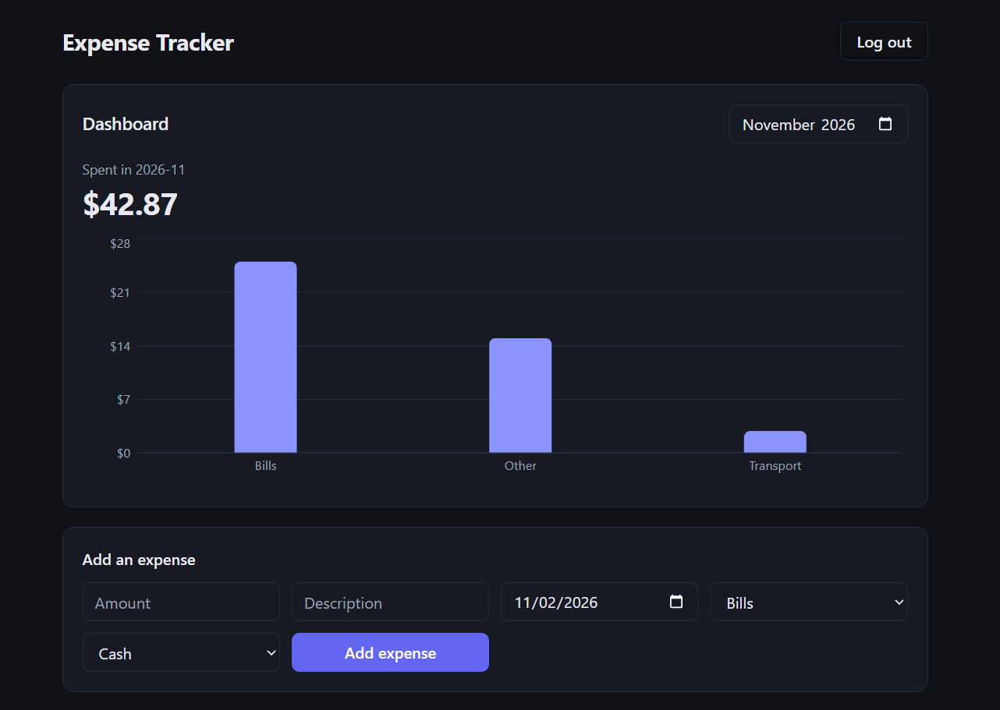

# Expense Tracker

A full-stack web app for logging what you spend, sorting it into categories, and seeing where your money goes each month.

**Live demo:** https://expense-tracker-pzfg.onrender.com

> The demo runs on a free hosting plan. It goes to sleep after about 15 minutes without visitors, so the first load can take up to a minute. Its database is also reset whenever the service restarts, so accounts and expenses do not last. Just register a new account to try it.



## Features

- **Accounts:** register and log in. Passwords are hashed with bcrypt, and sessions use signed JWT tokens.
- **Private data:** every user only ever sees their own categories and expenses.
- **Expenses:** add, list, edit (API) and delete expenses, with a category, date, description and payment method.
- **Categories:** each new account starts with six default categories (Food, Transport, Rent, Shopping, Bills, Other).
- **Dashboard:** pick a month to see the total spent and a bar chart of spending by category.
- **Accurate money:** amounts are stored as whole cents, so there are no floating-point rounding errors.
- **Responsive design:** works on phones and desktops, with automatic light and dark themes.

## Tech stack

| Part | Tools |
|---|---|
| Frontend | React (Vite), Recharts, plain CSS |
| Backend | Node.js, Express 5 |
| Database | SQLite (`better-sqlite3`) |
| Auth | `bcryptjs`, `jsonwebtoken` |
| Hosting | Render |

## Run it locally

You need [Node.js](https://nodejs.org) 20 or newer.

```bash
git clone https://github.com/Masterpiece168/expense-tracker.git
cd expense-tracker

npm install                 # server dependencies
npm install --prefix client # client dependencies
```

Development uses two terminals.

```bash
# Terminal 1: the API server on http://localhost:3000
npm run dev

# Terminal 2: the React app on http://localhost:5173
cd client
npm run dev
```

Open http://localhost:5173. The React dev server forwards `/api` requests to the Express server.

To run it the way it runs in production, as one server that also serves the built React app:

```bash
npm run build
npm start
```

Then open http://localhost:3000.

### Environment variables

| Variable | Purpose | Default |
|---|---|---|
| `JWT_SECRET` | Secret used to sign login tokens. **Required when `NODE_ENV=production`.** | a development-only value |
| `PORT` | Port the server listens on | `3000` |
| `DB_PATH` | Location of the SQLite file | `expenses.db` |
| `NODE_ENV` | Set to `production` when deployed | not set |

## API overview

All routes except register, login and health need the header `Authorization: Bearer <token>`.

| Method | Path | What it does |
|---|---|---|
| `POST` | `/api/auth/register` | Create an account |
| `POST` | `/api/auth/login` | Log in and receive a token |
| `GET` | `/api/categories` | List your categories |
| `POST` | `/api/categories` | Add a category |
| `GET` | `/api/expenses` | List your expenses, newest first |
| `POST` | `/api/expenses` | Add an expense |
| `PUT` | `/api/expenses/:id` | Replace an expense |
| `DELETE` | `/api/expenses/:id` | Delete an expense |
| `GET` | `/api/stats/monthly?month=2026-11` | Total and per-category totals for a month |
| `GET` | `/api/health` | Check that the server is running |

## Project structure

```
index.js        Express server: routes, login guard, validation
db.js           SQLite connection and table definitions
client/         React app (Vite)
  src/          Login, dashboard, expense form and list
```

## What I learned

Building this taught me how a full-stack app fits together: designing database tables and relationships, writing a REST API with validation, password hashing and token-based login, connecting a React frontend to an API, and deploying it online.

## Possible next steps

- Edit an expense from the interface (the API already supports it)
- A persistent database in production
- Budgets per category (the table already exists)
- Automated tests